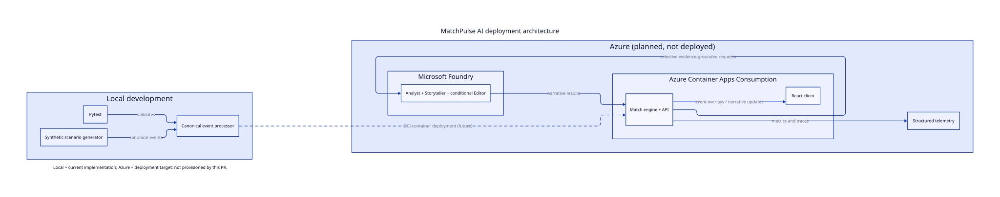
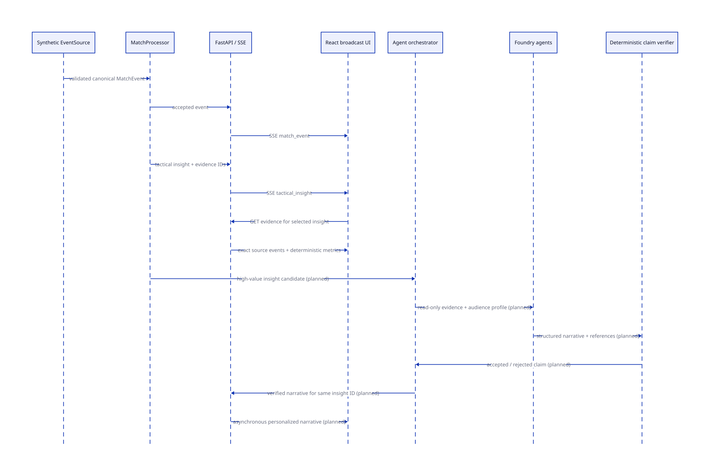
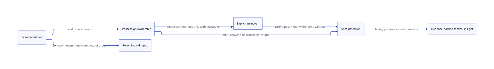
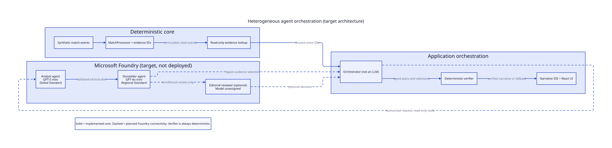

# PitchVolt AI — Software Architecture

This is the architectural entry point. **D2 source is authoritative**, while embedded SVGs are generated automatically to make the design readable in GitHub. The views explicitly distinguish *implemented* and *planned* behaviors.

## 1. Deployment view

[Editable D2 source](diagrams/deployment.d2) · [Rendering and exports](rendering.md)

The current implementation contains a canonical Python domain, FastAPI/SSE transport and a React/TypeScript live broadcast. Development uses Docker Compose with separate API and Vite processes; the production OCI build compiles React and serves it same-origin from the FastAPI runtime. [Development commands](../development.md). Azure Container Apps and Foundry remain intended deployment components, **not provisioned by this implementation**.

## 2. Dynamic sequence — From a football action to evidence-backed presentation

[Editable D2 source](diagrams/streaming-sequence.d2)

The event source supplies a canonical event to the `MatchProcessor`. Each accepted event updates state and can emit a deterministic tactical insight with evidence IDs. FastAPI immediately publishes canonical events and insights over SSE. React renders those facts and can retrieve the immutable evidence set for an insight. Foundry Analyst/Storyteller calls and narrative verification remain the approved **planned** slow path.

## 3. Tactical process / state flow

[Editable D2 source](diagrams/tactical-state.d2)

Input validation precedes state mutation. A possession change requires an explicit turnover; otherwise the processor rejects the event. On a shot, the engine inspects a bounded causal window and may classify a pressing-assisted recovery or counterattack. [Business rules and worked examples](business-logic.md).

[Unified source replay data and cursor contract](replay-data.md) · [Authored fictional team, score and substitution presentation](fixture-presentation.md) · [Real-time replay API: behavior, contracts, and operational limitations](realtime-api.md) · [Live broadcast UI: behavior and contracts](frontend.md)

## 4. Maintenance contract

Every PR that changes architecture, behavior, or deployment must update relevant D2 sources **and** written explanation, regenerate checked SVGs, and keep all diagrams consistent with actual implementation. Validate rendering in the **Architecture diagrams** CI job and visually inspect the embedded Markdown images. No hand-maintained duplicate diagrams.

PDF and PPTX exports are produced as workflow artifacts; multi-board animations and clickable board navigation are available when future diagrams justify them. GitHub inline SVG embeds do not preserve interactive links, so this page provides ordinary links to each source and related documentation.

## Input-adapter boundary

The current `Synthetic EventSource` deployment box includes an additional **local** StatsBomb-shaped fictional adapter (issue #15). It translates 120 × 80 native provider coordinates into the same canonical 105 × 68m `MatchEvent`; all downstream arrows and deployed topology in the diagrams are unchanged. The adapter is not a remote StatsBomb service, and neither real historical import nor live provider ingestion is implied. [Data format and limits](../synthetic-data.md).

## 5. Heterogeneous specialist-agent orchestration

[Editable D2 source](diagrams/agent-orchestration.d2) · [ADR-0002 model-assignment addendum](../decisions/ADR-0002-agent-orchestration.md)

The core owns every football fact. The planned Foundry Analyst uses **GPT-5 mini (Global Standard)** to examine read-only evidence, and the planned Storyteller uses **GPT-4o mini (Regional Standard)** for audience-specific structured selection. An **optional Editorial specialist has no assigned model**; it is invoked only if evidence-based evaluation supports its additional expense. The orchestrator and verifier are deterministic application components, **not extra AI agents**. The local orchestration and constrained evidence function exist, but the two-model Foundry execution, model-initiated cloud tool calls, cost measurement and Editorial invocation remain unverified or unimplemented.

The diagram indicates intended model placement, not deployed resources. Azure inference remains disabled until separately approved.
